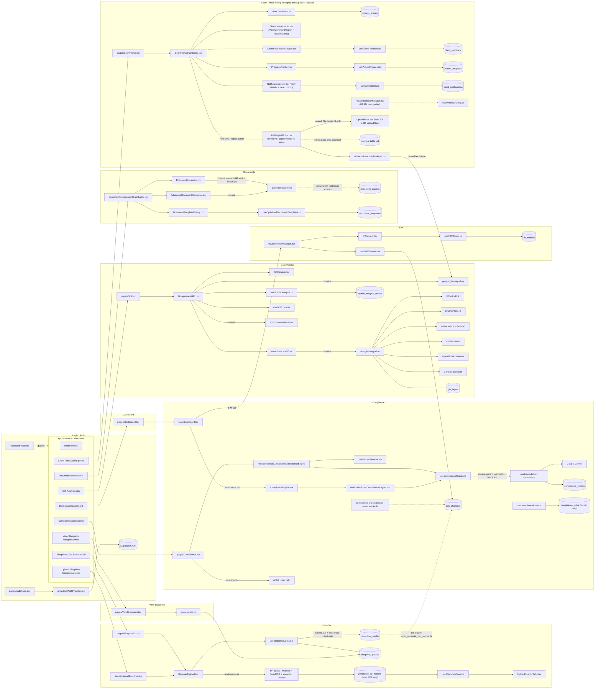

# CitadelTwin — Project Map

Generated by codebase trace (read-only exploration, no code changed). This file is meant to let any AI tool understand the whole project without opening every source file. Status values are honest: **WORKING** = fully functional end-to-end, **PARTIAL** = works but with real gaps/placeholders, **STUB** = UI exists, no real logic behind it, **BROKEN** = wired up but fails/no-ops, **DEAD** = code exists but unreachable from any live route.

## Recent changes

| Date | Change |
|---|---|
| 2026-08-05 | Re-verified all existing sections against current code (all prior line citations still accurate; fixed one stale claim — `project_progress` table is actually read via join in `useProjectProgress.ts`, not orphaned). Added full **Client Portal** feature section (was previously only mentioned in passing). Documented new **Add New Project** modal (phase-1, capture-only) under Client Portal. Updated architecture graph and file index accordingly. |

## 1. Project overview

CitadelTwin is an AEC (architecture/engineering/construction) SaaS product: users upload 2D blueprints, get an auto-generated 3D model and BIM element list, run GIS/environmental site-risk analysis on an address, check jurisdiction building-code compliance, and generate documents/reports — all behind Supabase Auth.

**Tech stack by layer:**
- **Frontend:** React 18.3 + Vite 5.4 + TypeScript 5.5, Tailwind 3.4 + shadcn/ui (~49 components), React Query, react-three-fiber / Google `<model-viewer>` for 3D, `web-ifc` / `web-ifc-viewer` for BIM/IFC, OpenCV.js + Tesseract.js (client-side blueprint processing)
- **Backend:** Supabase Postgres (59 tables, RLS), Supabase Storage (buckets: `blueprints`, `3d-models`, `ifc-models`, `documents`)
- **Edge functions:** 22 Deno-based Supabase Edge Functions (only ~9 are actually reachable from the live frontend — see §4)
- **External processing pipeline:** a separate Python FastAPI service (`blueprint-pipeline/` in-repo, deployed to a HuggingFace Space) doing real YOLOv8 + EasyOCR + Voronoi + `trimesh` GLB export
- **Auth:** Supabase Auth (email/password + Google/Azure/Okta OAuth wired client-side)
- **External APIs:** Google Gemini, OpenAI GPT-4o (dead code path), Google Maps/Places, FEMA NFHL, USGS PAD-US, USDA NRCS SSURGO, USFWS NWI, OpenFEMA, US Census geocoder, eCFR, plane2scene.com (dead code path)

---

## 2. Feature map

### 2D-to-3D Conversion
| | |
|---|---|
| Nav entry | `AppSidebar.tsx:24` "Blueprint → 3D" → `/blueprint-3d`; also `:23` "Upload Blueprints" → `/blueprints/upload` |
| Route | `App.tsx:110-118` (`/blueprint-3d` → `Blueprint3D.tsx`), `App.tsx:100-108` (`/blueprints/upload` → `UploadBlueprint.tsx`) |
| Page / children | `pages/Blueprint3D.tsx`, `pages/UploadBlueprint.tsx` → shared core `components/upload/BlueprintUpload.tsx` → `UploadForm.tsx`, `UploadResults.tsx` → `UploadResultsTabs.tsx` |
| Hooks | `useSimplifiedUpload.ts` (upload + client-side detection), `use3DModelViewer.ts` (poll/display) |
| Backend | detection is 100% client-side (no edge fn); 3D generation is a direct `fetch`, not an edge function |
| External APIs | HF Space `sathvikvadavatha-citadeltwin-pipeline.hf.space/process` (real YOLOv8 wall/door/window detection + EasyOCR + Voronoi room segmentation + `trimesh` GLB export, source in `blueprint-pipeline/`); OpenCV.js CDN; `unpkg.com/@google/model-viewer` |
| DB tables | `blueprint_uploads`, `detection_results`, `generated_3d_models`; storage buckets `blueprints`, `3d-models` |
| **Status** | **PARTIAL** — detection/geometry pipeline is genuinely real, not mocked. But the generated GLB is only ever a browser-session `blob:` URL (`BlueprintUpload.tsx:91-104`) — never uploaded to the `3d-models` bucket, so it's lost on reload/for other users. Room-type classification (`classifyRoomType`) is defined but unused (rooms just numbered). Two more fully-built pipelines exist (`process-blueprint-3d` Gemini-based BIM reconstruction, `plan2scene`/`plane2scene` chain) but are DEAD — reachable only from `pages/Index.tsx`, which is never routed. |

### GIS Analysis
| | |
|---|---|
| Nav entry | `AppSidebar.tsx:26` "GIS Analysis" → `/gis` (unconditional, no flag/role gate) |
| Route | `App.tsx:140-148` |
| Page / children | `pages/GIS.tsx` → `components/gis/GoogleMapsGIS.tsx` → `GISSidebar.tsx`, `utils/analysisSummary.ts` |
| Hooks | `useAdvancedGIS.ts`, `useSpatialAnalysis.ts`, `useGISExport.ts` |
| Backend | `get-google-maps-key`, `environmental-analysis`, `real-gis-integration` |
| External APIs | FEMA NFHL, USGS PAD-US, USDA NRCS SSURGO, USFWS NWI, OpenFEMA disasters, US Census geocoder — all **live**, with `Math.random()` synthetic-data fallback on failure (except OpenFEMA, which returns empty); Google Maps/Places (live) |
| DB tables | `gis_layers`, `property_boundaries`, `spatial_analysis_results` |
| **Status** | **WORKING** core flow (address search → live layers → map render), but with an honesty gap: silent synthetic-data fallback is never surfaced to the user, and there are 3 independent, non-unified risk-scoring formulas (`buildSuitabilityScore`, `getRiskLevel` client-side, `generateSpatialAnalysisResults` backend/dead). |

### View Blueprints
| | |
|---|---|
| Nav entry | `AppSidebar.tsx:25` "View Blueprints" → `/blueprints/view` |
| Route | `App.tsx:120-128` |
| Page / children | `pages/ViewBlueprints.tsx` (inline `BlueprintCard`) |
| Hooks | `useUploads.ts` |
| Backend | none — direct Supabase Postgres read + Storage signed URL |
| External APIs | none |
| DB tables | `blueprint_uploads` (primary); `detection_results`/`generated_3d_models` joined but never rendered; storage bucket `blueprints` |
| **Status** | **WORKING** — fully functional list/thumbnail/status/delete flow, real data throughout. Minor gap: fetches 3D-model/detection data via join but doesn't surface it (no "view 3D model" link from this page). |

### Compliance
| | |
|---|---|
| Nav entry | `AppSidebar.tsx:27` "Compliance" → `/compliance`; **duplicate path** via Dashboard's "Compliance" tab |
| Route | `App.tsx:130-138` |
| Page / children | `pages/Compliance.tsx` → `RefactoredMultiJurisdictionComplianceEngine.tsx` → `JurisdictionSelector`, `JurisdictionInfoPanel`, `ComplianceStatsCards`, `ComplianceActions`, `ComplianceViolationsList`/`ComplianceRulesList`. Dashboard path: `MainDashboard.tsx` → `ComplianceEngine.tsx` → `MultiJurisdictionComplianceEngine.tsx` |
| Hooks | `useComplianceRules.ts`, `useComplianceViolations.ts`, `useComplianceChecks.ts`, `useJurisdictions*.ts`, `useGeminiAI.ts` |
| Backend | `multi-jurisdiction-compliance` (wired, AI-text-based — **buggy**); `compliance-check` (real numeric rule-evaluation engine against `bim_elements` — **DEAD**, never invoked) |
| External APIs | Google Gemini (via `multi-jurisdiction-compliance`); eCFR public API (direct client call in `Compliance.tsx`, separate federal-regs search feature — this part works) |
| DB tables | `compliance_rules` (only 5 seeded rows, all generic IBC 2021), `compliance_violations`, `compliance_checks`, `jurisdictions`, `jurisdiction_codes` |
| **Status** | **BROKEN** — `useComplianceChecks.ts:62-69` sends `{ jurisdictionId, checkType, ... }` but `multi-jurisdiction-compliance/index.ts` expects `{ jurisdiction, elements, buildingType, ... }`; `requestData.elements.slice(0,5)` throws on undefined before Gemini is even called — "Run Comprehensive Check" 500s. The real rule-math engine (`compliance-check`) is dead code. Jurisdiction rule content is a hardcoded generic list, not a real code database. A DB trigger auto-creates `compliance_checks` rows on upload completion that stay stuck at `status:'running'` forever (no worker ever completes them). |

### BIM
| | |
|---|---|
| Nav entry | **none** — only reachable as a tab inside Dashboard |
| Route | none dedicated; lives inside `/dashboard` |
| Page / children | `MainDashboard.tsx` "BIM" tab → `BIMElementsManager.tsx` → `CreateBIMElementModal`, `IFCModelsManager`/`IFCUpload`/`IFCViewer`/`IFCElementPropertiesPanel`, `MaterialsManager`, `ElementConstraintsPanel` |
| Hooks | `useBIMElements.ts`, `useIFCModels.ts`, `use3DViewer.ts`; services `ifcClassifier.ts`, `bimIfcSync.ts` |
| Backend | none dedicated; DB trigger `auto_generate_bim_elements()` auto-populates `bim_elements` from `detection_results` |
| External APIs | none for data; `web-ifc` WASM binary from `unpkg.com` |
| DB tables | `bim_elements`, `ifc_models`, `materials` |
| **Status** | **PARTIAL** — real parametric BIM data model + real client-side IFC file parsing/classification/import (genuine functionality, not a label). But: no nav/route (buried in a Dashboard tab), disconnected from the GLB 3D pipeline (two independent, non-synced code paths process the same upload — editing a BIM element doesn't affect the viewed GLB), IFC relationship extraction is an explicit stub (always returns `[]`), geometry defaults to a placeholder 1×1×1 box when IFC lacks quantities. |

### Dashboard
| | |
|---|---|
| Nav entry | `AppSidebar.tsx:22` "Dashboard" → `/dashboard`. Separate `:21` "Home" → `/home`, which is the **actual post-login landing page** (see `LoginPage.tsx:36-45` redirect default) |
| Route | `App.tsx:90-98` |
| Page / children | `pages/Dashboard.tsx` → `MainDashboard.tsx` (6 tabs: Upload, 3D View, BIM, Compliance, Documents, GIS) |
| Hooks | `useUploads`, `useSimplifiedUpload`, `use3DModelViewer`, `useDetectionRooms` (+ each tab's own hooks) |
| Backend | indirect, via tabs: blueprint/3D, compliance, GIS edge functions |
| External APIs | `model-viewer` CDN + whatever each tab pulls in |
| DB tables | `blueprint_uploads` + tab-inherited tables |
| **Status** | **WORKING** as a page (real Supabase-backed hooks/tables in every tab, no hardcoded data in `MainDashboard.tsx` itself), but it embeds the same broken Documents tab (see below), and there is a **dead decoy component** `components/dashboard/Dashboard.tsx` (100% hardcoded fake stats like `"94%"`, fake "Jane" welcome message) sharing the same export name `Dashboard` — unused, but a trap for future readers searching by filename. |

### Documents
| | |
|---|---|
| Nav entry | `AppSidebar.tsx:28` "Documents" → `/documents` |
| Route | `App.tsx:201-211` → renders `DocumentManagementDashboard` **directly** (the matching `pages/Documents.tsx` file exists but is never imported — dead) |
| Page / children | `DocumentManagementDashboard.tsx` → `DocumentTemplateLibrary`, `AdvancedDocumentGenerator`, `DocumentGenerator`, `DocumentTemplateManager` |
| Hooks | `useOptimizedDocumentTemplates.ts` (works, read-only), `useOptimizedDocumentExports.ts` / `useDocumentExports.ts` (broken), `useGeminiAI.ts` (works, AI text preview only) |
| Backend | `generate-document` (**broken**, see below); `gemini-ai` (works); `generate-advanced-document` (wired to `useAdvancedDocuments.ts`, but that hook has zero importers anywhere — unreachable in practice) |
| External APIs | Google Gemini |
| DB tables | `document_templates` (read works), `document_exports` (write path broken), `document_variables` |
| **Status** | **BROKEN**, confirmed root cause: the client never inserts a `document_exports` row before invoking `generate-document`, and never sends an `exportId`. The edge function (`generate-document/index.ts:36`) then does `.update(...).eq('id', exportId)` against `undefined` — a no-op against a row that doesn't exist. The function also never uploads anything to Storage (`// Store the generated document (simplified - would normally upload to storage)` — comment in the code itself). Any later "download" call fails because nothing was ever persisted. Template selection in the Library tab is also disconnected (dead React state) from the Generator tabs, and Library template IDs are fabricated strings (e.g. `"residential-0"`) that don't match any real row. |

### Login / Authentication
| | |
|---|---|
| Nav entry | none in sidebar (public route); "Sign Out" control lives at `AppSidebar.tsx:83-92` |
| Route | `App.tsx:66-70` (`/auth/login`) — one of only two unprotected routes (with `/`) |
| Page / children | `pages/AuthPage.tsx` (view-switcher) → `LoginPage`, `SignupPage`, `ForgotPasswordPage`, `ResetPasswordPage` (share `AuthLayout`) |
| Hooks / services | `providers/AuthProvider.tsx` (`signIn`/`signUp`/`signInWithOAuth`/`signOut`/`updatePassword`), `components/ProtectedRoute.tsx` (route guard) |
| Backend | none custom — direct Supabase Auth SDK calls |
| External APIs | Supabase Auth (hosted); OAuth providers Google/Azure/Okta wired client-side (provider config lives in Supabase dashboard, unverifiable from repo; `'okta'` requires an `as any` type cast — not natively supported by this SDK version's types) |
| DB tables | Supabase's own `auth.users` — no app-level table read/written directly by the auth flow |
| **Status** | **WORKING** — email/password sign-in/up, forgot-password, reset-password are all real, fully wired, no stubs. Caveats: OAuth provider setup can't be verified as configured from code alone; the "Two-factor authentication enabled for enhanced security" banner in `LoginPage.tsx:182-187` is purely decorative — there is no MFA/TOTP implementation anywhere in `AuthProvider.tsx` (misleading UI copy). |

### Client Portal
| | |
|---|---|
| Nav entry | `AppSidebar.tsx:29` "Client Portal" → `/client-portal` |
| Route | `App.tsx:151-159` |
| Page / children | `pages/ClientPortal.tsx` (thin wrapper) → `ClientPortalDashboard.tsx` (4 tabs: Shared Projects, Feedback, Progress, Notifications) + `AddProjectModal.tsx` |
| Hooks | `useClientPortal.ts` (dashboard stat cards), `useClientFeedback.ts`, `useProjectProgress.ts`, `useNotifications.ts`, `useProjectSharing.ts` (used by orphaned `ProjectSharingManager.tsx` — see §8) |
| Backend | none dedicated — all direct Supabase Postgres reads/writes, keyed off `user.email`; no edge function for this feature |
| External APIs | none, except the new Add New Project modal reuses `get-google-maps-key` (via `AddressAutocompleteInput`, same technique as GIS) |
| DB tables | `project_shares`, `client_feedback`, `client_notifications`, `project_progress`, `projects` (joined) |
| **Status** | **PARTIAL / being reshaped.** The existing tab view (Shared Projects / Feedback / Progress / Notifications) is genuinely Supabase-backed, not mocked — see per-component notes below. But this whole feature is mid-pivot into a **project tracker** (see "Direction" below), and the newly added "Add New Project" flow (this update) is capture-only with no persistence yet. |
| Known dead UI | `ClientPortalDashboard.tsx:43-51` top-level "Notifications" button has no `onClick` (decorative). `SharedProjectsList.tsx` View/Comment/Export buttons have no `onClick` (decorative). `NotificationCenter.tsx` "View Details" button (shown when `action_url` present) has no `onClick`. `ProjectSharingManager.tsx` is fully built (share-by-email, permissions, revoke, all real via `useProjectSharing.ts`) but is never imported anywhere — dead/orphaned. |
| **Direction (planned, not built)** | Being reshaped from a generic "shared projects" viewer into a **project tracker**: a dedicated **input table** for project details (captured by Add New Project), a separate **results table** for pipeline output, a **tracker list** showing project name + status per row, a **manual approval** action, and a **results modal** opened per project. None of this exists yet — today's tabs (Shared Projects/Feedback/Progress/Notifications) and tables (`project_shares`/`client_feedback`/`project_progress`) are the pre-pivot implementation and may be superseded. |

#### Add New Project (phase 1 — capture only)
| | |
|---|---|
| Trigger | `ClientPortalDashboard.tsx:39-42` "Add New Project" button → `isAddProjectOpen` state (`:26`) → rendered at `ClientPortalDashboard.tsx:55` |
| New files | `AddProjectModal.tsx` (dialog + form + validation + submit handler), `AddressAutocompleteInput.tsx` (Google Places autocomplete input, reused technique from `GoogleMapsGIS.tsx`), `buildingTypeOptions.ts` (static building type → sub-type lookup) |
| Changed file | `ClientPortalDashboard.tsx` — added `Plus`-icon button and `isAddProjectOpen` state (`useState`), renders `<AddProjectModal open onOpenChange>` |
| What it does | Opens a Radix Dialog with blurred backdrop (`bg-black/80 backdrop-blur-sm`). Collects: project name, client name, a site address resolved via Google Places (or Enter-key geocode fallback) to `{ formattedAddress, lat, lng }`, a building type + dependent sub-type (from `buildingTypeOptions.ts`), and a blueprint file (reuses `components/upload/UploadForm.tsx` from the 2D-to-3D upload flow, but only for its file-picker UI — no actual upload happens here). Every field is validated (see `errors` object, `AddProjectModal.tsx:46-53`); submit is disabled until all pass. |
| On submit | Builds a plain object and `console.log`s it (`AddProjectModal.tsx:75-87`), shows a success toast, resets and closes the modal. **No Supabase call of any kind** — no insert, no storage upload, no edge function invoke. |
| **Status** | **PARTIAL — phase 1 of a multi-phase build.** Not built yet: no DB input table to persist this data, no file upload to Storage (blueprint file metadata — name/size/type — is captured but the `File` object itself is discarded on submit), no processing/pipeline trigger, no results of any kind. The captured object is currently unreachable after the toast disappears (component state, not app state). |

Captured object shape (`AddProjectModal.tsx:75-84`) — for designing the next-phase input table:
```ts
{
  projectName: string;
  clientName: string;
  siteAddress: { formattedAddress: string; lat: number; lng: number } | null;
  buildingType: string;       // e.g. 'residential'
  buildingSubType: string;    // e.g. 'single_family'
  blueprintFile: { name: string; size: number; type: string } | null;
}
```

---

## 3. Architecture graph



---

## 4. Edge function inventory

| Function | What it does | Feature | Live from frontend? |
|---|---|---|---|
| `get-google-maps-key` | Returns Google Maps JS API key from secret | GIS | **Live** |
| `environmental-analysis` | Point-in-polygon flood/protected/soil classification against cached `gis_layers` (no external network calls itself) | GIS | **Live** |
| `real-gis-integration` | Live external GIS API integration (FEMA/USGS/NRCS/USFWS/Census/OpenFEMA) + caching + mocked zoning/parcel actions | GIS | **Live** (some actions e.g. `zoning_analysis`, `fetch_property_boundaries` unused) |
| `gis-ingestion` | Layer ingestion job | GIS | Not called from this page's flow — likely cron/ingestion |
| `multi-jurisdiction-compliance` | AI-text-based jurisdiction compliance check via Gemini | Compliance | **Live but BROKEN** (request body param mismatch) |
| `compliance-check` | Real numeric rule engine (height/area/egress/fire/structural) vs `bim_elements` | Compliance | **Dead / orphaned** — never invoked |
| `generate-document` | Template-based document generation | Documents | **Live but BROKEN** (never persists export row or file) |
| `generate-advanced-document` | Gemini-enhanced advanced doc generation | Documents | Wired to `useAdvancedDocuments.ts`, but that hook has zero importers — **unreachable in practice** |
| `gemini-ai` | Central rate-limited Gemini proxy (text/code/blueprint/3D/architectural analysis) | cross-cutting | **Live** — heavily used across blueprint analysis + compliance actions + doc AI preview |
| `gemini-connection-test` | Gemini connectivity health-check | diagnostic | **Dead / orphaned** |
| `generate-3d-model` | Orchestrates external Python pipeline for 3D generation, with fake-placeholder GLB fallback | 2D-to-3D (legacy path) | Called only from the dead `Index.tsx`/`UploadPage` chain — **unreachable in practice** |
| `process-blueprint-3d` | Gemini-Vision "Geometric Reconstruction" full 3D pipeline, hand-built GLB export | 2D-to-3D (legacy path) | Called via raw `fetch` from `BlueprintTo3DConverter.tsx`, which is orphaned — **unreachable in practice** |
| `detect-objects` | GPT-4o multi-pass blueprint object detection, hardcoded fallback data on failure | 2D-to-3D (legacy path) | **Dead / orphaned** |
| `plan2scene-processor` | Converts blueprint data into Plan2Scene room/wall models | 2D-to-3D (legacy path) | Hook exists (`plan2sceneIntegration.ts`) but that hook is unreachable from any routed component — **unreachable in practice** |
| `plane2scene-3d` | Calls external `api.plane2scene.com` for textured GLB | 2D-to-3D (legacy path) | Same as above — **unreachable in practice** |
| `advanced-fea-integration` | Dynamic/nonlinear/modal/thermal FEA analysis | FEA (not in known feature list) | **Dead / orphaned** |
| `fea-analysis` | Structural FEA solver | FEA | **Dead / orphaned** |
| `real-fea-integration` | External FEA solver (CalculiX/OpenSees/Abaqus) integration | FEA | **Dead / orphaned** |
| `exec-sql` | Executes arbitrary SQL via service-role client | admin utility | **Dead / orphaned** (also a latent security concern if ever exposed) |
| `security-monitor` | Handles audit log / security event / backup / compliance-report actions | Security | **Dead / orphaned** — frontend bypasses it, writing tables directly via `useSecurity.ts` |
| `report-scheduler` | Finds due `scheduled_reports` and dispatches them; `verify_jwt=false` | Reports | Not invoked from frontend — cron/webhook target |
| `send-scheduled-report` | Emails a scheduled report via Resend; `verify_jwt=false` | Reports | Not invoked from frontend — presumably called server-side by `report-scheduler` |

**Entire FEA subsystem (3 edge functions + 5 DB tables) is dead end-to-end** — built at the schema/backend level, zero frontend references anywhere.

---

## 5. Database tables

Feature-relevant tables (of 59 total):

| Table | Holds | Used by |
|---|---|---|
| `blueprint_uploads` | uploaded blueprint file + processing status | 2D-to-3D, View Blueprints, Dashboard |
| `detection_results` | wall/door/window/room detection output per upload | 2D-to-3D, BIM (via trigger) |
| `generated_3d_models` | generated 3D model metadata (GLB path, often a `blob:` URL) | 2D-to-3D, Dashboard |
| `gis_layers` | cached external GIS layer data (flood/protected/soils/wetlands) | GIS |
| `property_boundaries` | parcel/property boundary geometry (server-only, mocked writer) | GIS (unused client-side) |
| `spatial_analysis_results` | stored intersection/zoning analysis output | GIS |
| `compliance_rules` | jurisdiction rule definitions (only 5 generic IBC rows seeded) | Compliance |
| `compliance_violations` | individual rule violations, FK to `bim_elements` | Compliance |
| `compliance_checks` | results of compliance-check runs (some stuck at `running` forever) | Compliance |
| `jurisdictions`, `jurisdiction_codes` | legal jurisdictions + code references | Compliance |
| `bim_elements` | parametric BIM elements (walls, geometry, params, IFC links) | BIM, Compliance (FK), 2D-to-3D (via trigger) |
| `ifc_models` | uploaded IFC model records | BIM |
| `materials` | material property/cost definitions | BIM |
| `document_templates` | reusable document templates | Documents (read works) |
| `document_exports` | generated export records | Documents (write path broken) |
| `document_variables` | per-export template variable values | Documents (unused — no matches) |
| `fea_analyses`, `fea_boundary_conditions`, `fea_loads`, `fea_meshes`, `fea_results` | FEA subsystem | **Dead** — zero frontend references |
| `project_shares` | client-facing share record (email, permissions, status, expiry) | Client Portal |
| `client_feedback` | client feedback items (type/status/content) | Client Portal |
| `client_notifications` | client-facing notifications (read/unread) | Client Portal |
| `project_progress` | progress % / milestones / recent updates, joined via `project_shares` | Client Portal — **used** (read via nested select in `useProjectProgress.ts`, contrary to an earlier pass of this doc which had this backwards) |

Other subsystems present but outside the 8 known features + Client Portal (cost estimation, collaboration, security/audit, workflows) each have their own live, correctly-wired tables (`cost_estimations`, `cost_line_items`, `collaboration_sessions`, `audit_logs`, `workflow_executions`, etc.) — not detailed here since they're not part of the requested feature set.

---

## 6. External data sources

| Source | Used for | Status |
|---|---|---|
| FEMA NFHL (`hazards.fema.gov`) | Flood zone polygons | **Live**, synthetic fallback on failure |
| USGS PAD-US (`gis1.usgs.gov`) | Protected/conservation lands | **Live**, synthetic fallback on failure |
| USDA NRCS SSURGO (`sdmdataaccess.sc.egov.usda.gov`) | Soils data | **Live**, synthetic fallback on failure |
| USFWS NWI (`fws.gov/wetlands`) | Wetlands polygons | **Live**, synthetic fallback on failure |
| OpenFEMA (`fema.gov/api/open`) | Disaster history | **Live**, no fallback (empty on failure) |
| US Census geocoder | County FIPS lookup | **Live**, silently defaults to Orange County, FL on failure |
| Google Maps / Places | Address search, map rendering | **Live** |
| Google Gemini | Compliance AI check, document AI preview, blueprint analysis (legacy) | **Live** (compliance path has a request-bug; document path works for preview text) |
| OpenAI GPT-4o | Blueprint object detection (legacy `detect-objects` fn) | **Dead code** — not called from any live path |
| HuggingFace Space (`sathvikvadavatha-citadeltwin-pipeline.hf.space`) | Real 2D-to-3D generation (YOLOv8 + EasyOCR + Voronoi + trimesh) | **Live** — this is the actual production 3D pipeline |
| `api.plane2scene.com` | Alternate textured-GLB generation | **Dead code** — hook unreachable |
| eCFR (`ecfr.gov`) | Federal regulation full-text search | **Live** — genuinely working, but generic federal-regs search, not code-compliance specific |
| `unpkg.com` CDN | `@google/model-viewer` script, `web-ifc` WASM | **Live** (CDN dependency, not a data API) |

---

## 7. Cross-cutting pieces

- **Auth:** `src/providers/AuthProvider.tsx` (session/sign-in/up/out/OAuth/password reset context around Supabase Auth SDK) + `src/components/ProtectedRoute.tsx` (route guard, redirect-with-`returnTo` logic). Every protected route wraps through this.
- **Shared layout:** `src/components/layout/EnhancedResponsiveLayout.tsx` (the shell actually used by `App.tsx`) + `AppSidebar.tsx` (live nav) + `MobileBottomNav.tsx`. `MobileOptimizedLayout.tsx` is used only by the orphaned `pages/Documents.tsx`.
- **Shared UI kit:** `src/components/ui/*` — shadcn/ui, ~49 components. `src/lib/utils.ts`'s `cn()` helper is imported by 60 files — the de facto standard styling utility.
- **Shared utilities used by 3+ features:** `src/utils/logger.ts` (12 files), `src/utils/errorHandling.ts` (8 files), `src/utils/performance.ts` (5 files), `src/integrations/supabase/client.ts` (the single Supabase client instance — every hook/edge-function-invoke goes through it).
- **Config:** `vite.config.ts`, `tailwind.config.ts`, `supabase/config.toml` (sets `verify_jwt=false` for `get-google-maps-key`, `environmental-analysis`, `report-scheduler`, `send-scheduled-report`, `process-blueprint-3d`), `.env` (only `VITE_SUPABASE_*` vars — server secrets like `GOOGLE_MAPS_API_KEY`/`GEMINI_API_KEY`/`OPENAI_API_KEY` live in Supabase project secrets, not the repo). `package.json`: React 18.3.1, Vite 5.4.1, `@supabase/supabase-js` 2.49.10, TypeScript 5.5.3, Tailwind 3.4.11.

---

## 8. Dead or orphaned code

Not wired into any live path — skip these when tracing a feature:

**Pages:** `src/pages/AIAssistant.tsx`, `src/pages/Collaboration.tsx`, `src/pages/Documents.tsx`, `src/pages/Index.tsx`, `src/pages/NotFound.tsx` (no catch-all route exists)

**GIS:** `src/components/gis/InteractiveGISMap.tsx`, `src/components/gis/GISExportPanel.tsx`

**Dashboard:** `src/components/dashboard/Dashboard.tsx` (fake decoy component, same export name as the real one)

**2D-to-3D legacy cluster (rooted at `pages/Index.tsx`, which is never routed):** `src/components/main/TabContentRenderer.tsx`, `src/components/upload/UploadPage.tsx`, `src/components/blueprint3d/BlueprintTo3DConverter.tsx`, `src/components/blueprint3d/Blueprint3DViewer.tsx`, `src/components/blueprint3d/BlueprintUploadBox.tsx`, `src/components/blueprint3d/ProcessingStatus.tsx`, plus hooks `useBlueprintUpload.ts`, `useBlueprintProcessing.ts`, `useBlueprintAnalysis.ts`, `useBlueprintFileUpload.ts`, `useGeminiBlueprint3D.ts`, `useEnhancedBlueprintAnalysis.ts`, `plan2sceneProcessor.ts`, `plan2sceneIntegration.ts`, `plane2sceneProcessor.ts`

**Compliance:** `src/components/compliance/jurisdiction/JurisdictionIcons.tsx`, edge function `compliance-check`

**Documents:** edge functions `generate-advanced-document` caller (`useAdvancedDocuments.ts`, zero importers)

**Client Portal:** `src/components/client-portal/ProjectSharingManager.tsx` (fully built share-by-email UI backed by real `useProjectSharing.ts`, but never imported by any routed component)

**Layout:** `src/components/layout/Header.tsx`, `Sidebar.tsx` (a second, unused sidebar with its own stale "GIS Integration" nav item — do not confuse with the live `AppSidebar.tsx`), `MobileHeader.tsx`, `ResponsiveLayout.tsx`

**Test/scratch:** `src/components/test/SupabaseConnectionTest.tsx`, `src/components/test/AuthenticationTest.tsx`

**Edge functions:** `advanced-fea-integration`, `fea-analysis`, `real-fea-integration`, `exec-sql`, `security-monitor`, `gemini-connection-test`, `detect-objects`, `generate-3d-model`, `process-blueprint-3d`, `plan2scene-processor`, `plane2scene-3d`

**DB tables:** the entire FEA table set (`fea_analyses`, `fea_boundary_conditions`, `fea_loads`, `fea_meshes`, `fea_results`), `document_variables`, `model_assemblies`, `assembly_elements`, `workflow_triggers`, `user_sessions`, `gis_data_updates`

---

## 9. File index

### 2D-to-3D
- `src/pages/Blueprint3D.tsx` — page, injects model-viewer script + upload UI
- `src/pages/UploadBlueprint.tsx` — thin wrapper page
- `src/components/upload/BlueprintUpload.tsx` — core orchestrator: upload → detect → external 3D fetch
- `src/components/upload/UploadForm.tsx`, `UploadResults.tsx`, `UploadResultsTabs.tsx` — upload UI + results display
- `src/hooks/useSimplifiedUpload.ts` — storage upload, DB insert, client-side detection trigger
- `src/hooks/use3DModelViewer.ts` — polls `generated_3d_models`, resolves model URL
- `src/utils/wallDetection.ts` — OpenCV.js contour/threshold wall detection
- `src/utils/enhancedRoomDetection.ts` — room polygon detection + unused `classifyRoomType`
- `src/hooks/blueprint/utils/textExtraction.ts` — Tesseract.js OCR
- `blueprint-pipeline/main.py` — FastAPI `/process` endpoint (external Python service)
- `blueprint-pipeline/pipeline/stage1_yolo.py` — YOLOv8 wall/door/window detection
- `blueprint-pipeline/pipeline/stage2_ocr.py` — EasyOCR text/room-label extraction
- `blueprint-pipeline/pipeline/stage3_voronoi.py` — geodesic Voronoi room segmentation
- `blueprint-pipeline/pipeline/stage4_topology.py` — room adjacency/topology
- `blueprint-pipeline/pipeline/stage5_export.py` — wall extrusion + real GLB export via `trimesh`

### GIS Analysis
- `src/pages/GIS.tsx` — page wrapper
- `src/components/gis/GoogleMapsGIS.tsx` — main map component (`@ts-nocheck`)
- `src/components/gis/GISSidebar.tsx` — layers/export/settings panel
- `src/components/gis/utils/analysisSummary.ts` — `buildSuitabilityScore`
- `src/hooks/useAdvancedGIS.ts`, `useSpatialAnalysis.ts`, `useGISExport.ts`
- `supabase/functions/get-google-maps-key/index.ts`, `environmental-analysis/index.ts`, `real-gis-integration/index.ts`

### View Blueprints
- `src/pages/ViewBlueprints.tsx` — list page + `BlueprintCard`
- `src/hooks/useUploads.ts` — query/dedupe/delete uploads

### Compliance
- `src/pages/Compliance.tsx` — page + hardcoded jurisdiction data + eCFR search
- `src/components/compliance/RefactoredMultiJurisdictionComplianceEngine.tsx`, `MultiJurisdictionComplianceEngine.tsx`, `ComplianceEngine.tsx`
- `src/components/compliance/JurisdictionSelector.tsx`, `PriorityJurisdictions.tsx`, `JurisdictionInfoPanel.tsx`
- `src/hooks/compliance/useComplianceRules.ts`, `useComplianceViolations.ts`, `useComplianceChecks.ts`
- `src/hooks/useJurisdictions.ts` + `src/hooks/jurisdictions/*`
- `supabase/functions/multi-jurisdiction-compliance/index.ts` (broken), `compliance-check/index.ts` (dead)

### BIM
- `src/components/bim/BIMElementsManager.tsx`, `CreateBIMElementModal.tsx`, `MaterialsManager.tsx`, `ElementConstraintsPanel.tsx`
- `src/components/ifc/IFCModelsManager.tsx`, `IFCUpload.tsx`, `IFCViewer.tsx`, `IFCElementPropertiesPanel.tsx`
- `src/hooks/useBIMElements.ts`, `useIFCModels.ts`, `use3DViewer.ts`
- `src/services/ifcClassifier.ts`, `bimIfcSync.ts`

### Dashboard
- `src/pages/Dashboard.tsx` — thin wrapper
- `src/components/dashboard/MainDashboard.tsx` — real 6-tab workspace
- `src/pages/Home.tsx` + `src/components/home/*` — actual post-login marketing/landing page

### Documents
- `src/components/documents/DocumentManagementDashboard.tsx` — real route target
- `src/components/documents/DocumentTemplateLibrary.tsx`, `AdvancedDocumentGenerator.tsx`, `DocumentGenerator.tsx`, `DocumentTemplateManager.tsx`
- `src/hooks/useOptimizedDocumentTemplates.ts`, `useOptimizedDocumentExports.ts`, `useDocumentExports.ts`, `useGeminiAI.ts`
- `supabase/functions/generate-document/index.ts` (broken), `gemini-ai/index.ts`

### Login / Auth
- `src/pages/AuthPage.tsx`
- `src/components/auth/LoginPage.tsx`, `SignupPage.tsx`, `ForgotPasswordPage.tsx`, `ResetPasswordPage.tsx`, `AuthLayout.tsx`
- `src/providers/AuthProvider.tsx`
- `src/components/ProtectedRoute.tsx`
- `src/integrations/supabase/client.ts`

### Client Portal
- `src/pages/ClientPortal.tsx` — thin wrapper page
- `src/components/client-portal/ClientPortalDashboard.tsx` — 4-tab dashboard + "Add New Project" trigger
- `src/components/client-portal/AddProjectModal.tsx` — **new**, phase-1 capture-only new-project dialog
- `src/components/client-portal/AddressAutocompleteInput.tsx` — **new**, Google Places autocomplete (reuses GIS's `get-google-maps-key` technique)
- `src/components/client-portal/buildingTypeOptions.ts` — **new**, static building type/sub-type list
- `src/components/client-portal/SharedProjectsList.tsx` — project list (View/Comment/Export buttons are dead)
- `src/components/client-portal/ClientFeedbackManager.tsx` — feedback submit/history, real data
- `src/components/client-portal/ProgressTracker.tsx` — progress %/milestones, real data
- `src/components/client-portal/NotificationCenter.tsx` — notifications list (mark read works, "View Details" dead)
- `src/components/client-portal/ProjectSharingManager.tsx` — **dead/orphaned**, never imported
- `src/hooks/useClientPortal.ts`, `useClientFeedback.ts`, `useProjectProgress.ts`, `useNotifications.ts`, `useProjectSharing.ts`

### Cross-cutting
- `src/components/layout/AppSidebar.tsx`, `EnhancedResponsiveLayout.tsx`, `MobileBottomNav.tsx`
- `src/lib/utils.ts`, `src/utils/logger.ts`, `src/utils/errorHandling.ts`, `src/utils/performance.ts`
- `src/App.tsx` — all route wiring
